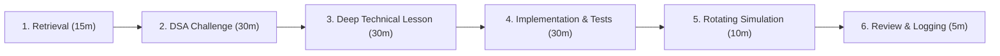

# Daily Training Workflow & Usage Guide

This guide walks through the daily routine, command usage, and interactive training protocols of the **Engineering Mastery OS**.

---

## 1. The Standard 120-Minute Daily Protocol

Every daily session is structured to build durable, compounding engineering mastery across multiple dimensions without topic overload:



---

## 2. Step-by-Step Training Walkthrough

### Step 1: Launching Today's Session
In the Antigravity chat or terminal, enter:
```text
/start
```
The **Master Orchestrator** checks:
1. `STATE/CURRENT-SESSION.md` for unfinished tasks.
2. `STATE/REVISION-QUEUE.md` for topics due for spaced repetition.
3. `STATE/WEAKNESS-REGISTER.md` for previous mistakes to revisit.

It opens with 2–3 targeted retrieval questions from past sessions.

---

### Step 2: Algorithmic Problem Solving (DSA)
- **Lead Agent**: `dsa_leetcode_coach`
- **Command**: `/dsa`
- **Protocol**:
  1. The coach presents a canonical problem, constraints, and LeetCode link.
  2. **You restate the problem** and propose brute force + Big-O analysis.
  3. You identify the bottleneck and state the invariant needed for optimization.
  4. **Progressive Hints**: If you get stuck, the coach provides one conceptual hint at a time. It never reveals the complete solution upfront.
  5. **Implementation**: You implement the solution in C# with boundary tests.
  6. **Outcome Logging**: The coach records the attempt in `DSA/PROBLEMS.md` as:
     - `independent_no_hints`
     - `independent_conceptual_hint`
     - `needed_implementation_hint`
     - `needed_solution_walkthrough`
     - `copied_reproduced_not_mastered`

---

### Step 3: Deep Technical Lesson
- **Lead Agent**: Specialist corresponding to the active theme (e.g. `csharp_dotnet_runtime_specialist` or `efcore_database_engineer`).
- **Command**: `/dotnet`, `/backend`, `/sql`, or `/frontend`
- **Structure**:
  1. **Motivation**: What problem caused this feature or mechanism to exist?
  2. **Internal Mechanism**: How does the runtime/engine execute it? (e.g. CLR method tables, JIT tiered compilation, GC card tables).
  3. **Mental Model**: Minimal diagrams, memory layouts, or execution timelines.
  4. **Production Pitfalls**: Concurrency bugs, allocation hazards, socket exhaustion.
  5. **Quick Check**: 2 conceptual questions testing your mental model before writing code.

---

### Step 4: Hands-On Implementation & Unit Testing
- **Lead Agent**: Specialist + `engineering_quality_reviewer`
- **Activity**: You write executable C#/.NET or TypeScript code directly in the workspace.
- **Workflow**:
  1. Write the code in `PROJECTS/` or `LABS/`.
  2. Write unit tests asserting happy paths and edge cases.
  3. Run the tests using `dotnet test`.
  4. Run `/review`: The **Principal Quality Reviewer** inspects your code against 15 dimensions (correctness, disposal, thread safety, DI lifetimes, allocation) and classifies any defects.

---

### Step 5: Rotating Engineering Simulation (10 minutes)
A fast-paced, high-impact exercise rotating daily through:
- **System Design (HLD)** (`/hld`): Back-of-the-envelope capacity bounds and database partitioning.
- **Forward Deployed Engineering** (`/fde`): Discovery questions for an ambiguous enterprise client request.
- **Production Debugging** (`/debug`): Diagnosing an intermittent high-CPU or deadlocking production incident from logs.
- **Application Security** (`/security`): Threat modeling a new API endpoint against OWASP Top 10 vulnerabilities.
- **Agentic AI** (`/agents`): Designing a tool schema and guardrail contract for an autonomous agent.

---

### Step 6: Review, Scoring & Progress Ledger Update
- **Lead Agent**: `orchestrator`
- **Summary**:
  1. Generates an objective score using the 100-point rubric.
  2. Records new mistakes in `STATE/WEAKNESS-REGISTER.md`.
  3. Schedules revision dates in `STATE/REVISION-QUEUE.md` (1d, 3d, 7d, 14d, 30d).
  4. Updates ratings in `STATE/COMPETENCY-MATRIX.md` with verifiable evidence.
  5. Sets the next task checkpoint in `STATE/CURRENT-SESSION.md`.

---

## 3. Handy Mid-Session Commands

- `/progress`: View your hours trained, phase status, and verified competency ratings.
- `/weakness`: Review your top open engineering gaps and remediation plans.
- `/research [topic]`: Ask the CS Fundamentals Researcher to inspect Microsoft Learn / specifications for version-specific facts.
- `/checkpoint`: Print an atomic summary snapshot of your current state.
- `/continue`: Resume exactly where you left off after pausing or restarting.
