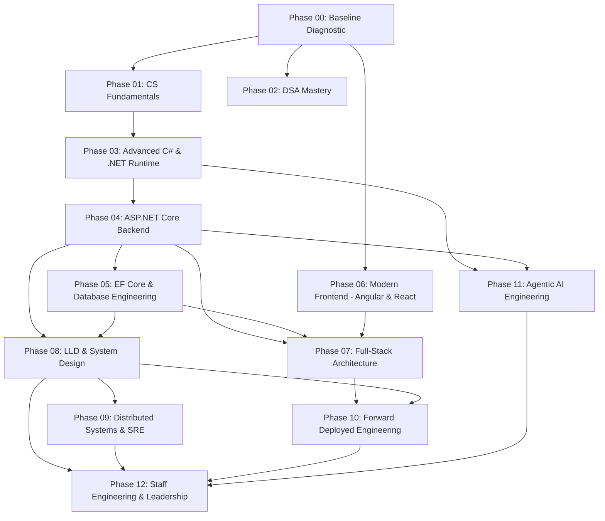

# Engineering Mastery Curriculum Roadmap

> **Target Standard: Experienced Senior/Staff Software Engineer & Forward Deployed Engineer (8–10 years engineering maturity level).**

---

## 1. Curriculum Principles

1. **Competency-Gated, Not Time-Locked**: Progression is dictated by demonstrated, verified evidence—not merely completing readings or watching tutorials.
2. **First Principles to Production**: Every subject follows the strict sequence:
   $$\text{Fundamentals} \longrightarrow \text{Internals} \longrightarrow \text{Mental Model} \longrightarrow \text{Implementation} \longrightarrow \text{Tests} \longrightarrow \text{Optimization} \longrightarrow \text{Architecture} \longrightarrow \text{Evaluation}$$
3. **Continuous Retrieval Practice**: Spaced repetition queues (1d, 3d, 7d, 14d, 30d) continuously resurface past algorithmic mistakes, language subtleties, and design trade-offs.

---

## 2. The 13 Phases of Mastery

---

### Phase 00: Baseline Diagnostic & Gap Identification
- **Lead Agent**: Master Orchestrator & Senior/Staff Interviewer
- **Objective**: Establish an empirical baseline across DSA, C#/.NET, SQL, frontend, architecture, debugging, FDE, and communication.
- **Gate Criteria**: Interactive diagnostic completed; `COMPETENCY-MATRIX.md` initialized with verified evidence.

### Phase 01: Computer Science & Operating Systems Fundamentals
- **Lead Agent**: CS Fundamentals Researcher
- **Core Topics**: Number representations, CPU cache hierarchy (L1/L2/L3, cache lines, false sharing), virtual memory, page tables, TLB, process context switches, thread scheduling, OS file I/O, networking stack (Ethernet, IP, TCP handshake/flow control, TLS 1.3, HTTP/2/3).
- **Gate Criteria**: Explain OS scheduling and memory layout without notes; implement a socket-level protocol parser.

### Phase 02: Data Structures & Algorithmic Problem Solving (DSA)
- **Lead Agent**: DSA and LeetCode Coach
- **Core Topics**: 26 algorithmic patterns in C# (Two Pointers, Sliding Window, Monotonic Stack, Binary Search invariants, Tree DFS/BFS, Backtracking, Graphs/Dijkstra/Topological Sort, Dynamic Programming 1D/2D/State-Machine).
- **Gate Criteria**: Solve unseen LeetCode Medium problems independently within 25 minutes; provide formal Big-O proofs.

### Phase 03: Advanced C# & .NET Runtime Internals
- **Lead Agent**: C# and .NET Runtime Specialist
- **Core Topics**: CLR execution, metadata, IL, JIT tiered compilation, GC generations (Gen 0/1/2, LOH, POH), DATAS memory tuning, `Span<T>`, `Memory<T>`, `ref struct`, async state machines, thread pool work-stealing.
- **Gate Criteria**: Build a zero-allocation streaming parser; diagnose and fix simulated memory leaks in memory dump labs.

### Phase 04: ASP.NET Core Backend Architecture
- **Lead Agent**: ASP.NET Core Backend Architect
- **Core Topics**: Kestrel, request pipeline middleware, DI scope validation, captive dependencies, Minimal APIs, Problem Details, OAuth2/OIDC, JWT claims transformations, rate limiting, Polly resilience.
- **Gate Criteria**: Design and implement a high-throughput, resilient backend service with integration test suite and zero captive dependencies.

### Phase 05: Entity Framework Core & Database Engineering
- **Lead Agent**: EF Core & Database Engineer
- **Core Topics**: Relational schema normalization/denormalization, B-Tree index structures, covering indexes, query execution plan analysis, ACID isolation levels (Read Committed, Snapshot, Serializable), deadlocks, EF Core change tracking.
- **Gate Criteria**: Predict SQL generation; resolve deadlocks under concurrent simulation; optimize slow queries using targeted indexing.

### Phase 06: Modern Frontend Engineering (Angular & React)
- **Lead Agent**: Angular and React Specialist
- **Core Topics**: Browser rendering pipeline, event loop, TypeScript type mechanics, Angular (Signals, RxJS streams, dependency injection, reactive forms), React (Hooks, reconciliation engine, context, error boundaries), WCAG accessibility.
- **Gate Criteria**: Build accessible, reactive component workflows with deterministic state management; eliminate state race conditions.

### Phase 07: Full-Stack Architecture & Delivery
- **Lead Agent**: Backend Architect & Frontend Specialist
- **Core Topics**: End-to-end multi-tier architecture, API contracts, CORS/CSRF defenses, unified telemetry, CI/CD container delivery.
- **Gate Criteria**: Deliver full-stack capstone project with automated end-to-end integration tests.

### Phase 08: Low-Level Design (LLD) & High-Level System Design (HLD)
- **Lead Agent**: System Design Specialist
- **Core Topics**: Object modeling, SOLID principles, GoF design patterns, capacity estimation, service boundaries, sharding, replication, eventual consistency, CAP theorem, distributed transactions.
- **Gate Criteria**: Complete mock system design interviews for high-scale platforms; defend capacity estimates and trade-offs.

### Phase 09: Distributed Systems, Cloud & Site Reliability (SRE)
- **Lead Agent**: DevOps, Cloud and SRE Specialist
- **Core Topics**: Consensus (Raft/Paxos concepts), partitioning, OpenTelemetry tracing, Prometheus metrics, SLI/SLO/SLA error budgets, chaos testing, incident post-mortems, blue/green rollbacks.
- **Gate Criteria**: Diagnose simulated distributed deadlocks and network partitions; execute automated rollbacks.

### Phase 10: Forward Deployed Engineering (FDE) & Customer Problem Solving
- **Lead Agent**: Forward Deployed Engineer Coach
- **Core Topics**: Ambiguous customer discovery, stakeholder interviews, legacy system integration, mTLS/firewalls, enterprise identity federation, rapid working prototypes, customer runbooks.
- **Gate Criteria**: Deliver complete client solution proposal, working integration prototype, and handover runbook.

### Phase 11: Agentic AI Systems Engineering
- **Lead Agent**: Agentic AI Systems Engineer
- **Core Topics**: LLM tool calling, typed planner/executor loops, memory graphs, prompt injection defenses, multi-agent evaluation metrics, cost/latency optimization.
- **Gate Criteria**: Implement and evaluate an autonomous multi-agent system with typed tools and safety guardrails.

### Phase 12: Staff/Principal Engineering & Technical Leadership
- **Lead Agent**: Senior/Staff Interviewer & Master Orchestrator
- **Core Topics**: Cross-team architectural governance, RFC authoring, failure post-mortems, executive framing, staff interview simulations.
- **Gate Criteria**: Score Advanced/Mastered across senior/staff interview simulations; publish an architectural RFC.
