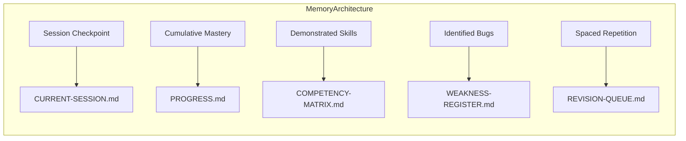
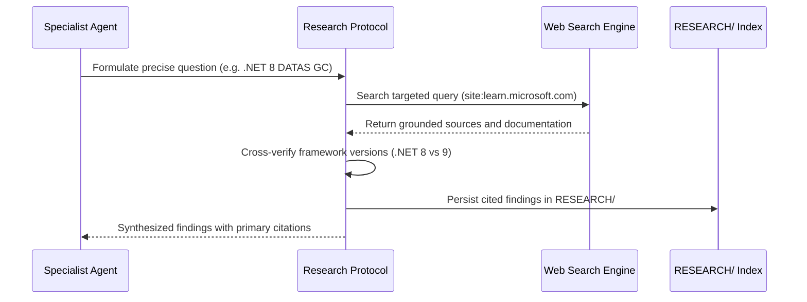

# System Architecture & Technical Specifications

This document outlines the architecture, data-flow models, multi-agent coordination protocols, and persistence mechanisms of the **Engineering Mastery OS**.

---

## 1. High-Level Architectural Diagram

```mermaid
flowchart TD
    User([Learner / Engineer]) -->|CLI Command or Chat Prompt| Gateway[Command & Request Dispatcher]
    
    subgraph OrchestrationLayer [Central Orchestration & Governance]
        Gateway --> Orchestrator[Master Engineering Orchestrator]
        Orchestrator --> StateMgr[State & Progress Manager]
        Orchestrator --> CurricEngine[Curriculum & Phase Gate Engine]
    end

    subgraph SpecialistAgentPool [Specialist Agent Execution Pool]
        Orchestrator -->|Delegates Focused Domain Task| CS[CS Fundamentals Researcher]
        Orchestrator -->|Algorithmic Challenge| DSA[DSA & LeetCode Coach]
        Orchestrator -->|CLR & Memory Deep Dive| DotNet[C# & .NET Runtime Specialist]
        Orchestrator -->|API & Resilience Task| Backend[ASP.NET Core Backend Architect]
        Orchestrator -->|Index & Query Plan Tuning| DB[EF Core & Database Engineer]
        Orchestrator -->|Signals & Reconciliation| Frontend[Angular & React Specialist]
        Orchestrator -->|Architecture & Capacity| SysDesign[System Design Specialist]
        Orchestrator -->|Enterprise Integration| FDE[Forward Deployed Coach]
        Orchestrator -->|Telemetry & SRE Drill| SRE[DevOps & Cloud Specialist]
        Orchestrator -->|Threat Modeling| Sec[Application Security Engineer]
        Orchestrator -->|Mock Interview Probe| Interviewer[Senior/Staff Interviewer]
        Orchestrator -->|Tool Calling & Guardrails| AI[Agentic AI Systems Engineer]
    end

    subgraph QualityAndVerification [Verification & Gate Enforcement]
        SpecialistAgentPool --> Reviewer[Principal Engineering Quality Reviewer]
        Reviewer -->|Challenges Implementation & Catches Defects| Orchestrator
        Orchestrator --> ResearchEngine[Adaptive Web Research Engine]
        ResearchEngine -->|Microsoft Learn / GitHub Specs| PrimarySources[(Authoritative Docs)]
    end

    subgraph PersistenceLayer [Atomic Persistence Layer]
        StateMgr -->|Atomic Write & Read| StateFiles[(State Files / Markdown & JSON)]
        StateFiles --> Profile[PROFILE.md]
        StateFiles --> Progress[PROGRESS.md]
        StateFiles --> Matrix[COMPETENCY-MATRIX.md]
        StateFiles --> Weakness[WEAKNESS-REGISTER.md]
        StateFiles --> Revision[REVISION-QUEUE.md]
        StateFiles --> Session[CURRENT-SESSION.md]
    end
```



---

## 2. Multi-Agent Execution Models

The system supports four distinct execution topologies, providing flexibility across local terminal sessions and integrated agent environments:

### Mode 1: Antigravity Native Subagents (Asynchronous True Parallelism)
- **Lifecycle**: Configured via `define_subagent` and invoked via `invoke_subagent`.
- **Isolation**: Each specialist agent runs in its own background conversation context with custom system prompts and scoped tool capabilities.
- **Coordination**: The parent orchestrator receives reactive notifications upon task completion without polling.

### Mode 2: Dynamic Python Workflows (`run_workflow`)
- **Use Case**: Orchestrating multi-agent pipelines for substantial coding tasks.
- **Pattern**:
  ```python
  # Example dynamic workflow pipeline
  results = pipeline([
      agent("csharp_dotnet_runtime_specialist", "Implement high-throughput zero-allocation parser"),
      agent("engineering_quality_reviewer", "Review implementation for memory leaks and race conditions"),
      agent("security_engineer", "Threat model input sanitization and buffer overruns")
  ])
  ```

### Mode 3: Native Swarm (`swarm`)
- **Use Case**: Collaborative multi-agent debates on complex architectural decisions.
- **Pattern**: Master Orchestrator, System Design Specialist, and DevOps/SRE Specialist share a message board to debate trade-offs (e.g. Eventual Consistency vs Strong Consistency for financial ledger events).

### Mode 4: Local Orchestrator CLI (`TOOLS/orchestrator_cli.py`)
- **Use Case**: Completely offline or terminal-based execution.
- **Pattern**: Direct command dispatching, atomic state file updates, and diagnostic evaluations executed via Python 3.14.

---

## 3. Persistent Memory & State Architecture

To eliminate context loss between sessions, the system implements a **filesystem-backed persistent memory model**:



### Safe Atomic Persistence Mechanics
All state updates utilize atomic temporary file replacement (`_atomic_write_text` in `TOOLS/state_manager.py`):
1. State changes are serialized to a temporary file in the target directory (`tempfile.NamedTemporaryFile`).
2. Data is flushed and closed.
3. The temporary file atomically replaces the target state file (`replace()`).
4. **Result**: Zero risk of truncated or corrupted files if a process is interrupted.

---

## 4. Adaptive Research Engine Architecture

When version-sensitive, runtime-internal, or disputed claims arise, the system triggers the **Adaptive Web Research Protocol**:



### Research Standards
- **Priority**: Official Microsoft Learn > GitHub runtime source > Language specifications > Engineering papers.
- **Citation Mandate**: Claims must cite primary sources and state applicable framework versions.
- **Anti-Hallucination**: The system never invents URLs, benchmarks, CVEs, or company interview attributions.

---

## 5. Evaluation & Mastery Gate Engine

A concept is never marked as "Mastered" through passive reading or assisted code completion.

### The 100-Point Scoring Rubric
| Dimension | Max Points | Evaluation Focus |
|---|---|---|
| Conceptual Understanding | 20 | Mental model accuracy, first-principles explanation without jargon |
| Problem Solving | 15 | Problem decomposition, invariant identification, constraint verification |
| Implementation | 20 | Clean code structure, proper idiom usage, zero-allocation where required |
| Correctness & Testing | 15 | Unit/integration test coverage, edge-case assertions, bug-free execution |
| Architecture & Trade-Offs | 15 | Separation of concerns, design patterns, failure mode defenses |
| Communication | 10 | Concise technical articulation, executive framing |
| Engineering Discipline | 5 | Verification mindset, source validation, disciplined error handling |

### The 6 Mandatory Mastery Gates
Before a skill level transitions to `Mastered`:
1. **Accurate Explanation**: Can explain internal mechanics without memorized tropes.
2. **Independent Implementation**: Writes code without assisted walkthroughs.
3. **Passing Tests**: Implements comprehensive unit and boundary tests.
4. **Debugging Capability**: Diagnoses and resolves synthetic production bugs.
5. **Trade-Off Articulation**: Explains alternatives, bottlenecks, and costs.
6. **Transfer Ability**: Successfully applies the pattern to an unfamiliar variation.
